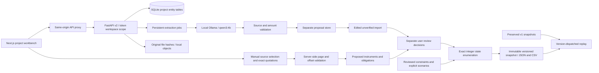

# Architecture — local evidence workbench

## Trust boundaries

Backend token mapping determines the workspace. Project ownership and every record lookup are scoped server-side. SQLite enforces project foreign keys; typed APIs validate cross-record links. Entity payloads remain individually stored JSON rather than a complete SQL projection of all fields.

Sources preserve document version, page, exact quote and offsets. Originals are content-addressed by raw-byte SHA-256. Source evidence is never executed as instructions. V2 optionally calls a loopback Ollama service. A persistent single-worker queue stores proposals separately; source-sentence and money-token schema enums constrain output. Invalid evidence or incomplete jobs publish no proposals. Imports create unverified records; separate user review remains mandatory. Extraction is experimental because the measured precision gate failed.

Input creation produces unreviewed records. A separate decision with a local reviewer and reason accepts the model input. Material edits revoke review; amendments invalidate affected claims, instruments and constraints. Unknown amounts, uncertain mapping, duplicated overlapping components and unfinished document reviews block completion. Hypothetical constraints cannot enter documented scenarios.

## Solver definition

Enumerate up to 20 binary conditional-claim dimensions, with fixed components always active. Apply only reviewed cardinality constraints selected by the scenario. Compute maximum modeled obligations separately from maximum instrument exposure.

An active FACE instrument contributes its full stressed face, regardless of claim exclusivity. A reviewed CLAIM_LIMITED instrument contributes the lesser of its stressed face and its additive active claims only where the scenario permits that basis. Hypothetical bases are excluded from documented baseline treatment. Terminal lifecycle alone does not remove exposure; reviewed release evidence is also required.

Scenarios store explicit conditional-amount and instrument-ceiling multipliers. Compare the maximum with gross exposure under identical stress. Unknown facility, cash, guarantee and surety metrics remain separate and nullable. The simple supported model does not represent a general payment waterfall or provide instrument-specific legal conclusions.

Every run stores immutable inputs, scenario, maximizing state, contributing instruments and hashes. New runs use enumeration-2.0. Historical v1 import preserves original snapshots and replay through enumeration-1.0 without altering their hashes.

## Later production gate

Managed PostgreSQL/RLS, encrypted versioned object storage, OIDC/MFA, user roles, vendor data controls and production security remain deferred. Require migration rehearsal, hash reconciliation, backup restoration, access tests and rollback before a confidential pilot. The local token system is not customer identity or professional authority.
